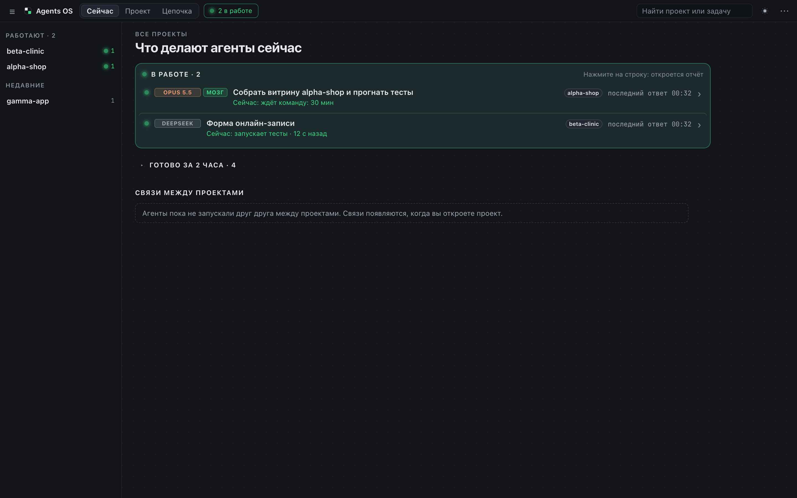
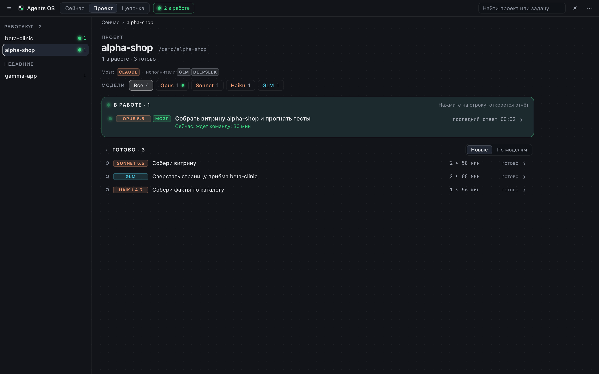
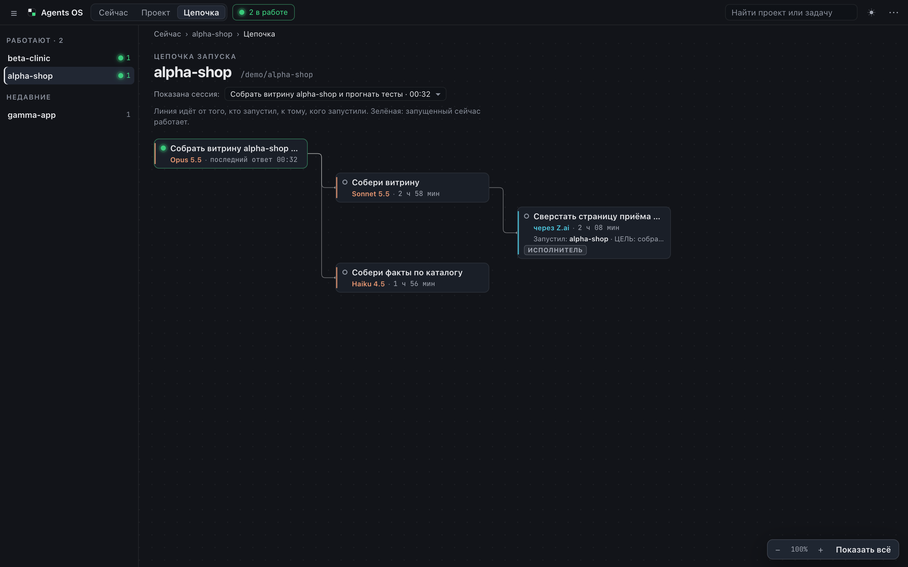
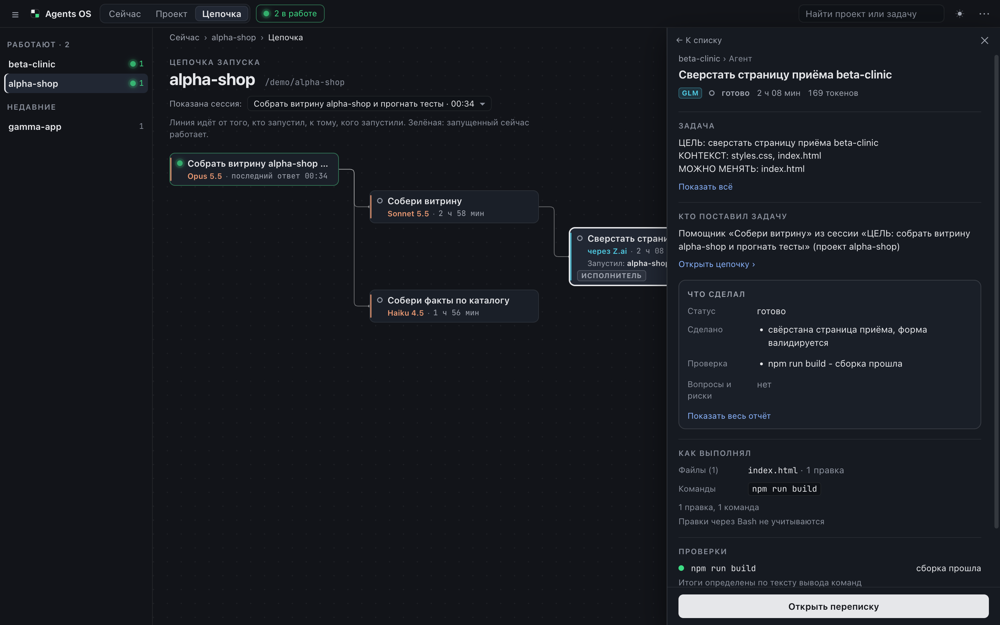

# Agents OS

Локальная карта агентов по всем проектам. Показывает, какие агенты Claude Code,
GLM-исполнители и Codex (GPT) работают прямо сейчас, на какой модели, над какой
задачей и кто кого запустил, в том числе между разными проектами.

Без зависимостей, сборки и CDN: Node 18+, встроенные модули, статика в `public/`.
Работает на macOS, Linux и Windows 10/11.

## Как выглядит

Скриншоты в `docs/img/` (демо-данные: `npm run demo`):

-  — **Сейчас**: кто работает по всем проектам, связи между проектами;
-  — **Проект**: строка «Мозг: Claude · исполнители: …», зоны «В работе» и «Готово»;
-  — **Цепочка**: кто кого запустил, у исполнителя метка «исполнитель» или «не в команде»;
-  — **Отчёт агента**: задача, что сделал, проверки, итог.

## Запуск

```bash
npm start
```

Это `node --max-old-space-size=384 server.js`. Открыть: http://127.0.0.1:3939

Посмотреть на демо-данных (три выдуманных проекта, ничего реального):

```bash
npm run demo
```

На Windows 10/11 те же команды работают в PowerShell. Нужен только Node 18+
(Node для Windows ставится со страницы nodejs.org). Папка `~` там это профиль
пользователя (`C:\Users\имя`): Agents OS читает `%USERPROFILE%\.claude\projects`,
`%USERPROFILE%\.glm-worker\projects` и `%USERPROFILE%\.codex\sessions`.
Подключение GLM и других исполнителей на Windows: раздел «Windows» в
[docs/CONNECT.md](docs/CONNECT.md).

```powershell
npm start
```

Окно 900x600 рядом с редактором достаточно: левая колонка сама сворачивается в
рельс. В окне до 700 px колонка выезжает по кнопке «☰», а панель агента занимает
весь экран.

Подключить GLM (Z.ai) и Codex (GPT) и настроить их работу вместе с Claude Code:
[docs/CONNECT.md](docs/CONNECT.md). Роли «мозг / исполнитель» — там же, раздел
«Роли: кто мозг, кто исполнитель»: файл, который агент правит в разговоре.

## Что видно

Одна схема: **проект** (папка), в нём **агенты** на разных моделях, у каждого
**задача**, вся работа записана в **переписке**. Экранов три, «агент» и «задача»
живут в одной строке.

- **Сейчас.** Стартовый экран. Зона «В работе» по всем проектам (в строке чип
  проекта), «Готово за 2 часа» свёрнуто, «Связи между проектами» (кто запускал
  кого в другом проекте). Счётчик «N в работе» в шапке ведёт сюда.
- **Проект.** Заголовок, полоса «Модели» (Opus, Sonnet, Haiku, GLM, GPT: чипы
  одновременно фильтр и легенда цветов), зона «В работе» с рамкой и тоном (это
  единственный выделенный блок экрана), ниже «Готово», свёрнуто, выбор
  запоминается. Строка в работе: модель, задача целиком (до двух строк), «Сейчас:
  правит Index.html · 14 с назад», время. Строка в «Готово»: одна строка и итог:
  «готово», «тесты не прошли» или «ошибка». Работающие всегда сверху: когда агент
  заканчивает, строка гаснет и появляется в «Готово».
- **Цепочка.** Дерево выбранной сессии: сессия, помощники, GLM-исполнители.
  Завершённые листья свёрнуты в «ещё N завершённых агентов». Масштаб: Ctrl или ⌘ и
  колесо, щипок на трекпаде, кнопки внизу справа. Пунктир с подписью «сообщение»
  или «повторный запуск» виден у выбранной карточки.
- **Отчёт агента.** Нажмите на строку: справа откроется карточка. Задача, что
  сделал (статус, сделано, блокеры, нужно решение, не сделано), как выполнял
  (файлы и ключевые команды), проверки (тесты, типы, сборка), итог. У GLM ещё
  «Кто поставил задачу» со ссылкой на цепочку. Кнопка «Открыть переписку» ведёт к
  полной ленте: вкладки Всё, Диалог, Задачи для GLM (с текстом ТЗ из
  `$(cat файл)`), Между агентами, Запуски агентов, Файлы; последние 300 событий,
  «Показать ранее», живое обновление. На экране от 1600 px панель можно закрепить.
- **Меню «⋯».** Размер строк (плотно, свободно), свернуть колонку, закрепить
  панель, «Скрыть пути» (для записи экрана: `/Users/имя/...` и `C:\Users\имя\...` заменяются на `~/...`),
  «Как читать карту» (плашка первого запуска), «Обновить сейчас». Меню
  управляется стрелками, Esc закрывает его и возвращает фокус на кнопку.
- **Вид.** Тёмная тема по умолчанию, светлая в шапке. Статус кодируется формой и
  цветом: залитая пульсирующая точка «в работе», кольцо «готово», красный квадрат
  «ошибка».

Слова на экране: «агент» (любая сессия), «главный» (сессия, с которой работает
человек), «помощник» (субагент), «GLM» (исполнитель через Z.ai). Статусы: «в
работе», «готово», «ошибка».

### Откуда берётся отчёт и чего он не знает

Отчёт собирается без чтения файла целиком: задача из первых 256 КБ, последнее
сообщение агента из хвоста (до 3 МБ с конца), файлы и проверки из индекса,
который строится потоком один раз. Структурный отчёт (два и больше заголовков из
СТАТУС, СДЕЛАНО, БЛОКЕРЫ, НУЖНО РЕШЕНИЕ, НЕ СДЕЛАНО) разбирается на тезисы,
свободный текст показывается первым абзацем и пунктами с пометкой «Отчёт без
разметки».

Ограничения:

- Правки файлов через Bash (`sed -i`, скрипты) не видны, только Edit, MultiEdit,
  Write и NotebookEdit. В карточке есть пометка.
- Итог проверок берётся из текста вывода, а не из кода возврата: конвейер
  (`| grep`, `| tail`) прячет код возврата, и красный прогон приходит как успешный.
  Распознаются vitest, jest, `node --test`, pytest, tsc, `make`/`npm run build`,
  `git diff --stat`. Нет результата в переписке: «итог не определён».
- «В работе» значит: файл менялся за последние 60 секунд, либо последняя запись
  это вызов инструмента без результата (тесты, сборка), но не дольше 15 минут.
- У главной сессии вместо длительности показано «последний ответ»: сессии живут днями.
- Для Codex (GPT) отчёта нет: карточка пишет «Для этого источника отчёта пока нет»
  и оставляет кнопку переписки.

## Как находятся связи

Связь «кто кого запустил» собирается из транскриптов:

1. Сессия и её субагенты: по `toolUseId` из `agent-<id>.meta.json`, иначе по
   описанию задачи, иначе по папке сессии.
2. `SendMessage`: поле `to` совпадает с id субагента.
3. Запуск исполнителя: в Bash-вызове ищется бинарь из `run.binaries` профиля
   с флагом запуска — `claude-glm -p …`, `claude-glm --resume <id>`,
   `agent-run <профиль> …`, `codex exec "…"`, `codex exec resume <id>`. Из
   команды берутся `cd <путь>` (проект исполнителя) и `--resume <id>`. Без
   `--resume` запуск сопоставляется с сессией исполнителя в том же `cwd`, у
   которой первая запись в пределах 2 минут после вызова. На Windows Claude Code
   выполняет Bash-команды в Git Bash, и `cd` в команде читается во всех видах:
   `cd /c/Проекты/x`, `cd C:/Проекты/x`, `cd "C:\Проекты\x"`, `cd ~/x`,
   относительный `cd` считается от рабочей папки вызова; все они дают проект
   `C:\Проекты\x`. Проект один, как бы ни был записан путь: буква диска заглавная,
   слэши обратные, регистр при сравнении не важен (пути WSL вида
   `\\wsl.localhost\...` остаются как есть и с регистром различаются). Упоминания в `ls`,
   `cat`, heredoc и тексте запуском не считаются. Вызов MCP-инструмента из
   `mcpTools` профиля (у codex: `mcp__codex__*`) — тоже запуск: сессия ищется
   так же, по `cwd` и времени; не нашлась — связь рисуется с пометкой «сессия
   не найдена».
4. Если `cd` ведёт в другой проект, это межпроектная связь. Она видна с обеих
   сторон: у сессии исполнителя написано, из какого проекта и какой сессии её
   запустили.

Вид ИИ определяется по источнику (папке), а не по полю `message.model`: у GLM
Z.ai подменяет его на `claude-opus-…`.

## Источники

Источники описываются профилями, а не кодом. Встроенные профили (claude, glm,
codex) работают без настроек; свой провайдер добавляется файлом
`~/.agents-os/providers.json` (папка переопределяется `AGENTS_OS_HOME`).
Адаптер включается, только если его папка существует.

| Источник | Папка по умолчанию | Переменная |
|---|---|---|
| Claude Code (профиль `claude`) | `~/.claude/projects` | `CLAUDE_PROJECTS_DIR` |
| GLM-исполнитель (профиль `glm`) | `~/.glm-worker/projects` | `GLM_PROJECTS_DIR` |
| Codex, GPT (профиль `codex`) | `~/.codex/sessions` | `CODEX_SESSIONS_DIR` |

Профиль в файле добавляет источник или переопределяет поля встроенного
(удалить встроенный нельзя; пустой или битый файл — работают встроенные,
предупреждение в лог):

```json
{
  "profiles": [
    {
      "id": "deepseek",
      "kind": "claude-like",
      "label": "DeepSeek",
      "historyDir": "~/.ds-worker/projects",
      "baseUrl": "https://api.deepseek.com/anthropic",
      "run": { "binaries": ["agent-run"], "printFlags": ["-p"], "resumeFlags": ["--resume", "-r"] }
    }
  ]
}
```

Поля: `kind` — род формата истории (`claude-like` или `codex`; по нему
выбирается разборщик, новых разборщиков для DeepSeek/Kimi/Qwen/MiniMax не
нужно), `historyDir`, `dirIsProject`, `reportSupported`, `baseUrl` и
`keychainService`/`mcpKeyEnv` для обёртки `tools/agent-run`, `run` — шаблоны
распознавания запуска (какие бинари и флаги в Bash-вызове значат «запустил
исполнителя» и «продолжил сессию»), `mcpTools` — имена MCP-инструментов, вызов
которых тоже считается запуском (у codex: `mcp__codex__*`). Моделей в профиле
нет: модель выбирает провайдер, своя — `AGENT_RUN_MODEL` при запуске. Путь
источника можно переопределить и переменной `<ID>_PROJECTS_DIR`
(claude-like) / `<ID>_SESSIONS_DIR` (codex).

Как добавить новый род формата истории (Gemini и другие — после проверки
формата на живом файле):

1. Создайте `lib/sources/<имя>.js` с функцией `create` (образцы:
   `lib/sources/claudeLike.js` и `lib/sources/codex.js`). `scanRecord`
   заполняет индекс одного транскрипта построчно: `cwd`, `firstTs`, `lastTs`,
   `models`, токены, `title`, `firstUser`, `lastErr`; `parseRecord` превращает
   запись в события ленты.
2. Добавьте род в `KINDS` в `lib/providers.js` и ветку в `loadAdapters`
   (`lib/sources/index.js`).
3. Добавьте разборщик в `lib/providers.js` (как встроенный профиль) или
   включайте профили с этим `kind` из `providers.json`.

Адаптер Codex написан по описанному формату rollout-файлов и проверен на
синтетическом файле. На живых сессиях Codex он не проверялся.

## Память

Транскрипты бывают по сотне мегабайт, поэтому файл целиком не читается никогда.

- `readFile` на `.jsonl` в коде нет. Разрешено: первые 256 КБ файла, чтение хвоста
  кусками, потоковое построчное чтение со строками не длиннее 1 МБ (длиннее
  пропускаются) и дочитывание новых байт по смещению. Всё это в `lib/lines.js`.
- Индекс файла строится потоком один раз и кэшируется по (путь, размер, mtime).
  Файл дописался: читаются только новые байты.
- При старте ничего не индексируется. Проект индексируется, когда его открыли,
  не больше двух файлов одновременно. На карту проекта берутся 40 свежих сессий
  (и не больше 1 ГБ транскриптов), остальные открываются по одной.
- Сервер стартует с `--max-old-space-size=384`. Если RSS выше 450 МБ
  (`RSS_LIMIT_MB`), тяжёлые запросы получают 503 с причиной и запись в лог.

Проверено: индекс синтетического файла 600 МБ занимает около 80 МБ RSS
(`npm test`, тест `test/memory.test.js`). Тот же файл с десятками тысяч правок и
прогонов тестов (поля «как выполнял» и проверок): пик около 90 МБ, в куче после
сборки мусора новые поля держат около 160 КБ. Они ограничены потолками: 60 путей,
30 команд, 30 итогов проверок, 40 имён инструментов; текст вывода в индекс не попадает.
Запрос `/api/report` не читает файл целиком: голова 256 КБ, хвост до 3 МБ, при RSS
выше порога отвечает 503.

## Переменные окружения

| Переменная | По умолчанию | Что делает |
|---|---|---|
| `PORT` | `3939` | Порт. Сервер слушает только 127.0.0.1 |
| `REDACT` | `1` | Маскировка секретов. `REDACT=0` выключает |
| `RSS_LIMIT_MB` | `450` | Порог RSS, выше которого тяжёлые запросы получают 503 |
| `CLAUDE_PROJECTS_DIR`, `GLM_PROJECTS_DIR`, `CODEX_SESSIONS_DIR` | см. таблицу выше | Папки источников (то же, что `<ID>_PROJECTS_DIR`/`<ID>_SESSIONS_DIR` для любого профиля) |
| `AGENTS_OS_HOME` | `~/.agents-os` (на Windows `%USERPROFILE%\.agents-os`) | Папка конфигурации: `providers.json`, `team.json`, `keys/` |

## Приватность

- Сервер слушает только `127.0.0.1` и отклоняет запросы с чужим заголовком `Host`
  (защита от DNS rebinding). API, кроме того, отклоняет межсайтовые запросы:
  с заголовком `Sec-Fetch-Site: cross-site` или с `Origin`, не совпадающим с
  `http://127.0.0.1:<порт>` / `http://localhost:<порт>`. Запросы без этих
  заголовков (curl, закладка, сам интерфейс) работают как раньше.
- На каждом ответе — `X-Frame-Options: DENY`, `X-Content-Type-Options: nosniff`,
  `Referrer-Policy: no-referrer`; на HTML ещё и CSP без внешних источников.
- Транскрипты никуда не отправляются, консоль ничего в них не меняет.
- Секреты маскируются на сервере до отдачи в браузер, в одном месте (любой JSON-ответ):
  ключи вида `<32 hex>.<токен>` (токен с `-` и `_` тоже), `sk-…`, `ghp_…`,
  `xoxb-/xoxp-…`, AWS `AKIA…`, Google `AIza…`, JWT, PEM-блок приватного ключа,
  `Bearer …`, пароль в URL (`scheme://user:pass@`), значения после имён переменных
  и полей с `password`, `passwd`, `secret`, `token`, `api_key`, `access_key`.
  Повторная маскировка уже замаскированного ничего не меняет. Выключается `REDACT=0`
  (при старте без маскировки сервер пишет предупреждение в лог).
- Границы путей (`$(cat файл)`, `/api/file`, `/api/session`) проверяются с раскрытием
  симлинков: файл должен лежать внутри домашней папки (для сессий — внутри папки
  источника) и после `realpath` тоже.
- Подстановка `$(cat файл)` и `/api/file` читают только `.md` и `.txt` внутри
  домашней папки, не больше 512 КБ (чтение через дескриптор), и не читают защищённые
  папки: `~/.ssh`, `~/.aws`, `~/.gnupg`, `~/.config`, `~/Library/Keychains`,
  `~/.claude`, `~/.codex`. Путь файла в карточке ТЗ показывается как `~/…`.
  На Windows путь из Git Bash (`/c/Users/имя/tz.md`) тоже понимается, а защищённые
  папки распознаются без учёта регистра (`.SSH` и `.ssh` одна папка).
- Лента отдаёт не больше 500 событий за запрос.
- Никаких npm-зависимостей, CDN и внешних запросов.

## Тесты

```bash
npm test
```

Разбор и маскировка, потоковое чтение, связи на синтетических транскриптах
(сессия, субагент, GLM, межпроектная связь, `--resume`), адаптер Codex,
HTTP-интерфейс (в том числе `/api/report`), разбор итогов проверок и текста отчёта,
«в работе» по висящему вызову, индекс файла 600 МБ с замером RSS (с правками и без),
дочитывание по смещению, пути и разбор `cd` в стиле Windows (Git Bash, PowerShell, UNC),
скрипты `tools/` с временным HOME и подставными ключами. Все данные в тестах выдуманные.

На Windows тесты симлинков пропускаются с причиной, если у пользователя нет права
создавать симлинки (режим разработчика или администратор); проверку тех же границ
через ссылку на папку (junction) это не отменяет. Тесты скриптов `tools/` идут
через Git Bash и пропускаются, если его нет; на macOS они пропускаются всегда:
скрипты там ходят в настоящую Связку ключей.

## Лицензия

MIT, см. [LICENSE](LICENSE).
